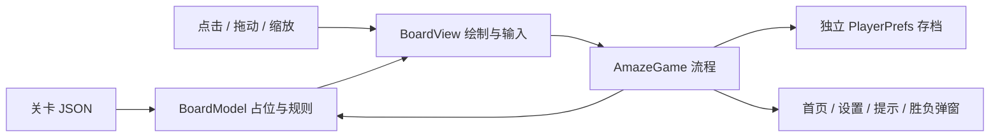

# Amaze GO! 拆解记录

分析日期：2026-10-09。目标是本机雷电模拟器中的 `com.oakever.arrows`，版本 1.33.0，versionCode 73。

## 已观察到的画面

启动页采用浅米色背景、红蓝折线箭头图标，文案为“午间玩30分钟，减压又充满活力”。首页显示继续第 5 关、五个关卡节点、蓝色水滴计数及设置按钮。活动卡片包括第 11 关解锁的联赛、第 70 关解锁的大逃鲨和每日挑战。

游戏随后弹出 Android 通知权限请求。该弹窗需要用户手动处理，本次未操作任何权限选项，因此未完成原版关卡内的实玩观察。下面的结构和关卡规则依据安装包数据；重建的手感参数并非测量所得。

## 安装包结构

| 项目 | 检查结果 |
| --- | --- |
| 游戏引擎 | `data.unity3d` 头部版本为 Unity 6000.3.16f1 |
| 脚本发布形式 | 包含 `global-metadata.dat`，为 IL2CPP 发布结构；没有原 C# 源码 |
| 资源索引 | `assets/AssetBundle/manifest.json`，351 个资源包记录 |
| 资源组织 | 配置、关卡、UI 预制体、动画、材质、声音、Sprite、Spine 等分类 |
| 标准资源流 | 所分析的 `.ab` 前 32 字节是附加头，其后为标准 UnityFS 数据 |
| 配置资源 | `config_core` 含 2 个 TextAsset；`levelconfigs` 含 665 个 TextAsset |
| 关卡资源 | `levelpacks_newuser` 含 21,204 个 TextAsset |
| 关卡编码 | 多数二维箭头布局是 GZip 压缩 JSON |

发现的活动相关资源名还包括 Arrow3D、ArrowClash、LinkDots、OctaArrows、OneLine、TimeAttack、CatEscape 等。资源存在不能证明当前账号已开放这些玩法，也不代表本工程已实现它们。

## 核心数据与规则

1. 解压后的关卡包含 `XSize`、`YSize`、`Arrows`。
2. 每支箭头的 `Points` 只保存转折点，需要补齐中间网格点进行阻挡判断。
3. 第一个点是箭头头部，方向为第一个点减去下一段上的相邻点。
4. 沿箭头方向扫描直到棋盘外；若命中其他箭头的任何占位点，该箭头不可退出。
5. 安全退出后释放整支箭头的占位，其余箭头可移动性可能变化。
6. 因为消除只减少障碍，可反复选取任意可退出箭头求解。

对同一批前 80 个关卡，“头在前”解释有 80 个可完整求解；“头在后”仅有 3 个。这提供了方向解释的证据。最终 997 个导入关卡在 Python 求解器和实际 Unity C# 实现中分别验证。

## 重建的系统划分

`BoardModel` 不依赖页面。`BoardView` 采用 UGUI 自定义网格，折线圆角与箭头头部通过几何绘制，不需要为每个网格点生成 GameObject。移动时将头部沿出口方向延伸、尾部沿旧路径收缩。`AmazeGame` 负责有效操作、生命、动画完成、状态保存和页面转换。

## 与原版的差异

- 确认保留：提取的布局、所选原始图片、已观察的首页主要结构。
- 数据推导：头部顺序、二维正交折线、其他箭头阻挡、消除依赖关系。
- 重写实现且未对照实测：动画曲线/时长、坐标 Y 朝向、碰撞反馈、生命值、缩放范围、结算 UI、提示方式、音效。
- 研究版辅助：全部关卡可选、提示免费、增加数据追溯与全关卡验证。
- 未还原：服务器与实验投放、联赛、每日挑战、大逃鲨等活动、付费与广告 SDK、账号同步、原始源码与原始编辑器预制体绑定。

本工程保留动态构建的页面和可编辑 C#，没有将打包的 MonoBehaviour 强行作为丢失脚本的预制体导入。资源原件和完整提取的 TextAsset 留在相邻 `AmazeGO_Analysis` 目录，便于后续扩大还原范围。
